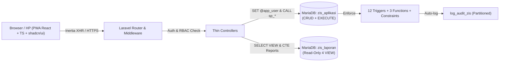
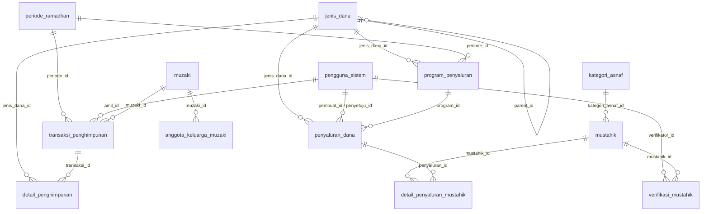
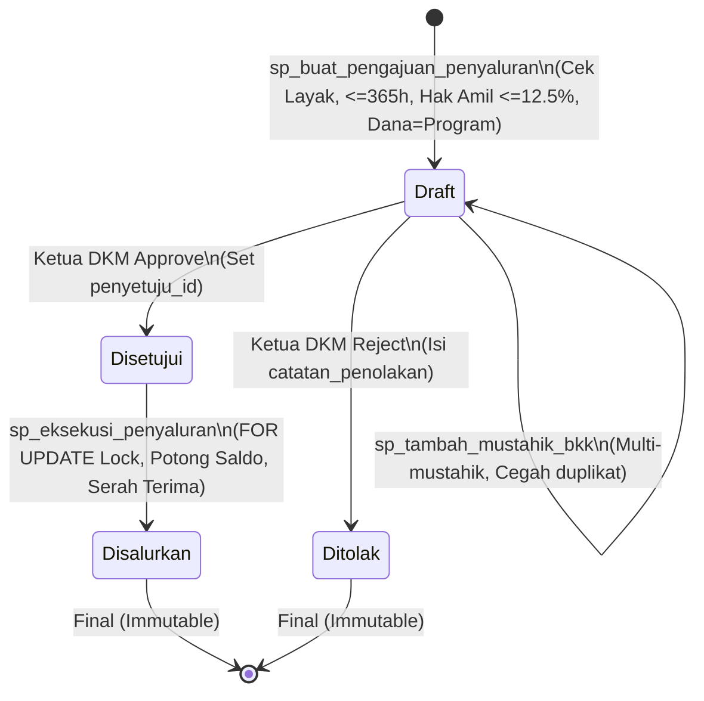

# System & UI/UX Architecture Design (`design.md`)
# Sistem Informasi Lembaga Amil Zakat (LAZ / ZIS) & Zakat Fitrah Masjid

---

## 1. Arsitektur Sistem Keseluruhan (Monorepo)

Aplikasi dibangun sebagai **single-repository monolith modern** menggunakan **Laravel (terbaru)** sebagai backend/orchestrator dan **React + TypeScript + shadcn/ui** di dalam folder Laravel melalui **Inertia.js**. Pendekatan ini menghilangkan kebutuhan memelihara API token terpisah untuk SPA, tetap mendapatkan type-safety TypeScript, serta mendukung **Progressive Web App (PWA)**.



### 1.1 Tech Stack Final
| Lapisan | Teknologi | Catatan Implementasi |
| :--- | :--- | :--- |
| **Backend Framework** | Laravel 11 / 12 (PHP 8.2+) | Thin Controllers, FormRequest validation, Inertia responses, PDF export (`barryvdh/laravel-dompdf`). |
| **Frontend Bridge** | Inertia.js (`@inertiajs/react`) | Routing sisi server Laravel, rendering sisi klien React tanpa REST boilerplate. |
| **UI Library** | React 18/19 + TypeScript (Strict) | Seluruh halaman & komponen menggunakan `.tsx` dengan tipe data terdefinisi di `resources/js/types/`. |
| **Design System** | **shadcn/ui** + Tailwind CSS + `lucide-react` | Komponen aksesibel berbasis Radix UI (`Card`, `Table`, `Dialog`, `Sheet`, `Select`, `Badge`, `Sonner/Toast`, `Form`). |
| **Charts** | Recharts (via shadcn/ui Chart) | Visualisasi tren YoY penghimpunan dan distribusi porsi 8 asnaf. |
| **PWA Engine** | `vite-plugin-pwa` (Workbox) | Web App Manifest, Service Worker, ikon installable, dan offline status detector. |
| **RDBMS** | MariaDB 10.6+ / MySQL 8.0+ | `db_laz_zis_masjid` (14 tabel, 4 VIEW, 3 FN, 12 TRG, 6 SP, 1 EVENT). |

---

## 2. Arsitektur Integrasi Laravel ↔ RDBMS MariaDB

### 2.1 Dual Database Connection (`config/database.php`)
Aplikasi **wajib** mengonfigurasi dua koneksi terpisah di `.env` dan `config/database.php`:
1. **`mysql` (Default — `zis_aplikasi`)**:
   - Digunakan untuk autentikasi, CRUD data master, dan seluruh eksekusi Stored Procedure (`CALL sp_*`).
   - Tidak memiliki hak `DROP` atau `ALTER`.
2. **`mysql_laporan` (Read-Only — `zis_laporan`)**:
   - Digunakan oleh Portal Transparansi Publik (`/transparansi`) dan endpoint pembacaan 4 `VIEW` (`v_laporan_penyaluran_publik`, `v_saldo_jenis_dana`, `v_rekap_penyaluran_asnaf`, `v_rekap_penghimpunan_muzaki`).
   - **Catatan:** Untuk 4 Query Laporan Analitik Wajib (Recursive CTE, YoY `LAG`, 8 Asnaf, Peringkat Muzaki) yang membaca tabel transaksi asli, gunakan koneksi `mysql` (khusus peran terautentikasi `Admin` / `Ketua_DKM`), sedangkan portal publik hanya boleh memakai `mysql_laporan` pada 4 `VIEW`.

### 2.2 Injeksi Identitas Audit (`@app_user`)
Semua trigger audit menggunakan `COALESCE(@app_user, USER())`. Agar `log_audit_zis` merekam nama pengguna Laravel yang sebenarnya (bukan sekadar `'zis_aplikasi@localhost'`), buat middleware `SetRdbmsAppUser`:
```php
// app/Http/Middleware/SetRdbmsAppUser.php
if ($request->user()) {
    $actor = sprintf('%s (%s)', $request->user()->username, $request->user()->peran);
    DB::statement('SET @app_user = ?', [$actor]);
}
```
Daftarkan middleware ini pada grup rute `auth` setelah sesi terautentikasi.

### 2.3 Adaptor Autentikasi (`pengguna_sistem`)
Tabel `pengguna_sistem` memiliki skema baku yang berbeda dari default Laravel `users`:
- Nama tabel: `pengguna_sistem`
- Kolom password: `password_hash`
- Kolom peran: `peran` (`Admin`, `Amil_Penerima`, `Verifikator`, `Staf_Penyaluran`, `Ketua_DKM`)
- Kolom aktif: `status_aktif` (`1` / `0`)

Pada model `App\Models\PenggunaSistem extends Authenticatable`:
- Set `protected $table = 'pengguna_sistem';`
- Override `getAuthPassword(): string { return $this->password_hash; }`
- Override `getAuthPasswordName(): string { return 'password_hash'; }`
- Saat login (`LoginRequest`), cek tambahan bahwa `status_aktif === 1` dan izinkan login menggunakan `username` atau `email`.

### 2.4 Penanganan Error RDBMS (`SQLSTATE 45000`)
Setiap kali Stored Procedure atau Trigger menolak operasi (misal hak amil > 12,5%, saldo tidak cukup, mustahik kedaluwarsa), MariaDB melempar `PDOException` / `QueryException` dengan SQLSTATE `45000` dan error code `1644`.
Buat helper/trait `HandlesRdbmsException` di Laravel:
- Tangkap `Illuminate\Database\QueryException`.
- Periksa `$e->getCode() === '45000'` atau `($e->errorInfo[1] ?? null) === 1644`.
- Ekstrak pesan bersih setelah `1644 ` (contoh: `PENOLAKAN SISTEM: Akumulasi hak amil melebihi batas maksimal syariat 12,5%...`).
- Kembalikan `back()->withErrors(['rdbms' => $cleanMessage])` agar Inertia menampilkannya sebagai Alert/Toast merah di UI React.
- Untuk error duplikat `UNIQUE` (code `23000` / `1062`), tampilkan pesan ramah (contoh: NIK atau No. Kwitansi sudah terdaftar).

---

## 3. Diagram Hubungan Entitas & Alur Transaksi (Mermaid)

### 3.1 Ringkasan ERD 14 Tabel


### 3.2 Alur Penyaluran Dana (State Machine BKK)


---

## 4. Struktur Direktori Proyek Target

```text
laz-zis-masjid/
├── app/
│   ├── Http/
│   │   ├── Controllers/
│   │   │   ├── Auth/AuthenticatedSessionController.php
│   │   │   ├── DashboardController.php
│   │   │   ├── Master/
│   │   │   │   ├── JenisDanaController.php
│   │   │   │   ├── PeriodeRamadhanController.php
│   │   │   │   ├── PenggunaSistemController.php
│   │   │   │   └── ProgramPenyaluranController.php
│   │   │   ├── MuzakiController.php
│   │   │   ├── PenghimpunanController.php
│   │   │   ├── MustahikController.php
│   │   │   ├── PenyaluranController.php
│   │   │   ├── LaporanController.php
│   │   │   ├── AuditLogController.php
│   │   │   └── TransparansiPublikController.php
│   │   ├── Middleware/
│   │   │   ├── HandleInertiaRequests.php
│   │   │   ├── EnsureRole.php
│   │   │   └── SetRdbmsAppUser.php
│   │   └── Requests/...
│   ├── Models/ (Read-only Eloquent mappings, tanpa mutasi saldo)
│   └── Support/RdbmsErrorHandler.php
├── database/ (TIDAK ADA migration destruktif; hanya dokumentasi/opsional)
├── public/
│   ├── icons/ (icon-192x192.png, icon-512x512.png, maskable)
│   └── manifest.webmanifest (atau di-generate vite-plugin-pwa)
├── resources/js/
│   ├── components/
│   │   ├── ui/ (Komponen shadcn/ui: button, card, dialog, sheet, table, badge, dll)
│   │   ├── layout/ (AppShell.tsx, SidebarNav.tsx, MobileBottomNav.tsx, OfflineBanner.tsx)
│   │   └── zis/ (RdbmsAlert.tsx, CurrencyInput.tsx, AsnafBadge.tsx, KwitansiPreview.tsx)
│   ├── layouts/
│   │   ├── AuthenticatedLayout.tsx
│   │   └── PublicLayout.tsx
│   ├── pages/
│   │   ├── Auth/Login.tsx
│   │   ├── Dashboard/Index.tsx
│   │   ├── Loket/Index.tsx (Entri cepat penghimpunan & riwayat kwitansi)
│   │   ├── Muzaki/Index.tsx & Show.tsx
│   │   ├── Mustahik/Index.tsx & VerifikasiModal.tsx
│   │   ├── Penyaluran/Index.tsx, Create.tsx, Show.tsx
│   │   ├── Master/ (JenisDana, Periode, Program, Pengguna)
│   │   ├── Laporan/Index.tsx (4 Tab Laporan Wajib + Grafik)
│   │   ├── Audit/Index.tsx (Diff JSON viewer)
│   │   └── Publik/Transparansi.tsx
│   ├── types/index.d.ts
│   └── app.tsx
├── routes/web.php
└── vite.config.ts (Konfigurasi Laravel + React + VitePWA)
```

---

## 5. Desain UI/UX & Responsivitas (shadcn/ui)

### 5.1 Identitas Visual & Palet Warna
- **Tema Utama:** *Clean Islamic Modern* — Latar terang (`bg-slate-50` / `bg-background`), permukaan kartu putih (`bg-card`) dengan border halus, aksen utama **Emerald (`emerald-600` / `#059669`)** untuk aksi positif & saldo Zakat, **Amber (`amber-500`)** untuk status `Menunggu`/`Draft`, dan **Rose (`rose-600`)** untuk status `Ditolak`/`Kedaluwarsa`/`Dibatalkan`.
- **Tipografi:** `Inter` atau `Plus Jakarta Sans` untuk keterbacaan angka finansial (`tabular-nums` wajib pada semua nominal Rupiah & Kg beras).

### 5.2 Pola Responsif Desktop vs Mobile (HP Panitia)
- **Desktop (`>= 1024px`):** Sidebar kiri tetap (*collapsible*) + Header bar dengan indikator **Periode Ramadhan Aktif** & badge **Realisasi Hak Amil (`x.xx% / 12.50%`)**.
- **Mobile (`< 768px`):**
  - Sidebar digantikan oleh **Bottom Navigation Bar** (maks 4-5 menu utama sesuai peran, misal untuk `Amil_Penerima`: *Beranda*, *Loket ZIS*, *Muzaki*, *Riwayat*) + tombol *Menu Lainnya* (`Sheet` drawer).
  - Data `Table` otomatis beralih menjadi **Card List** yang mudah di-tap dengan jari (target sentuh minimal `44x44px`).
  - Form input nominal & berat beras menggunakan `inputMode="decimal"` / `inputMode="numeric"` agar keyboard angka HP langsung muncul.

---

## 6. Arsitektur Progressive Web App (PWA)

1. **Instalasi (`manifest.webmanifest`):**
   - `name`: `"SI-LAZ Masjid — Zakat & Infak"`
   - `short_name`: `"LAZ Masjid"`
   - `display`: `"standalone"`
   - `theme_color`: `"#059669"`, `background_color`: `"#ffffff"`
   - `start_url`: `"/"`
2. **Service Worker (`vite-plugin-pwa`):**
   - **Precache:** Aset build Vite (JS, CSS, SVG/PNG ikon, font).
   - **Strategi Runtime Caching:**
     - **Aset Statis:** `CacheFirst`.
     - **Halaman Inertia & Transaksi (`POST`/`PUT`/`DELETE` atau rute `/loket`, `/penyaluran`, `/dashboard`):** `NetworkOnly` atau `NetworkFirst` dengan timeout pendek agar saldo dana tidak pernah menampilkan data basi (*stale balance*).
3. **Pengalaman Offline Aman:**
   - Komponen `OfflineBanner.tsx` memantau `navigator.onLine`. Saat koneksi terputus, banner kuning muncul dan tombol submit transaksi (`Simpan Kwitansi`, `Eksekusi Penyaluran`) dinonaktifkan sementara untuk mencegah inkonsistensi finansial.
4. **Install Prompt Banner:**
   - Tangkap event `beforeinstallprompt` di React untuk menampilkan tombol *"Install Aplikasi di HP"* pada header/profil bagi panitia yang belum meng-install.
